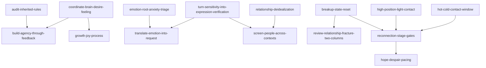

# V2.1 内部路由索引

先判断用户真正要完成的任务、当前关系阶段和下一步目标，再匹配语言信号。关键词只用于辅助，不能替代事实与行为证据。默认只选 1 个主模块；只有明确依赖时，增加最多 1 个辅助模块。

## 快速路由表

### 主体性、选择、内部状态与行动

| 用户的核心任务 | 典型语言信号 | 主模块 |
|---|---|---|
| 判断目标或规则究竟属于自己，还是来自家庭、学校、组织与社会脚本 | 这真是我想要的吗、父母安排、应该但一直拖延 | [audit-inherited-rules-before-choosing.md](audit-inherited-rules-before-choosing.md) |
| 协调理性计划、刺激欲望与持续实际感受 | 脑子知道但心里不想、理性和冲动打架、该听哪个 | [coordinate-brain-desire-and-feeling.md](coordinate-brain-desire-and-feeling.md) |
| 不再把他人认可或伴侣当唯一坐标，补建生活结构 | 怕被讨厌、没有他什么都没有、生活只有一个支点 | [agency-support-points.md](agency-support-points.md) |
| 为已确认的长期目标建立主动选择、短反馈和下一轮盼头 | 没行动力、准备很多没有交付、一次失败否定自己 | [build-agency-through-feedback.md](build-agency-through-feedback.md) |
| 判断放不下来自爱、欲望、不甘、恐惧还是被迫失去 | 明知不合适却放不下、必须得到、强行抽离 | [diagnose-desire-fear-fixation.md](diagnose-desire-fear-fixation.md) |
| 调整“他本来就应该”的必然期待 | 应该、必须回报、我付出了他就该 | [expectation-calibration.md](expectation-calibration.md) |
| 识别长期付出背后的隐性交换条件 | 委屈、讨好、不情愿还在做、突然爆发 | [resentment-hidden-contract.md](resentment-hidden-contract.md) |
| 追到弥散焦虑或愤怒背后的恐惧并分流 | 反刍、焦虑、愤怒，触发点或真正怕什么都不清楚 | [emotion-root-anxiety-triage.md](emotion-root-anxiety-triage.md) |
| 因低信息信号反复推演又不敢问，把猜测转成求证动作 | 他只回一个嗯、怕麻烦别人、不敢问但想了两天 | [turn-sensitivity-into-expression-and-verification.md](turn-sensitivity-into-expression-and-verification.md) |
| 已知具体触发，把它转成事实、需要、请求和修复 | 某件事后连续挑刺、你不爱我、不知道怎么说才不吵 | [translate-emotion-into-request.md](translate-emotion-into-request.md) |
| 停止逃避并完成一个已知、单次、短期具体问题的最小闭环 | 知道哪件事没处理、只想止痛、一个小问题拖着 | [face-solve-transcend.md](face-solve-transcend.md) |
| 判断一条长期路径该继续、重构还是停止 | 过程不快乐、没有成长、只等未来结果 | [growth-joy-process.md](growth-joy-process.md) |

### 恋爱认知、识人、关系体验与破裂复盘

| 用户的核心任务 | 典型语言信号 | 主模块 |
|---|---|---|
| 去掉滤镜，区分具体的人、现实生活与相处中的自己 | 上头、稳定等于无聊、爱的是感觉还是人 | [relationship-deidealization.md](relationship-deidealization.md) |
| 校准自身供给、可达范围、恐惧红线与择偶画像 | 配得感、我能吸引谁、理想伴侣、双方缺点是否相撞 | [value-positioning-mate-selection.md](value-positioning-mate-selection.md) |
| 通过跨场景重复行为和小成本验证识人，决定依赖级别 | 热恋期完美、对服务员苛刻、犯错后会不会修复 | [screen-people-across-contexts.md](screen-people-across-contexts.md) |
| 审计主动爱、被爱、过去留恋、当下体验和未来路径 | 没大错却想离开、只是在被爱、关系耗尽 | [audit-relationship-experience.md](audit-relationship-experience.md) |
| 关系已经破裂，分开对方选择、自己的可调部分与未知动机 | 到底谁的错、他是不是一直利用我、我该吸取什么 | [review-relationship-fracture-in-two-columns.md](review-relationship-fracture-in-two-columns.md) |
| 保持真诚但不把真诚变成回报合同 | 真诚换真诚、我这么认真他为何不回报 | [sincerity-without-contract.md](sincerity-without-contract.md) |
| 判断真实高低位、主动权和退出选择 | 谁高位、先联系会不会掉价、谁更怕失去 | [relationship-position-diagnosis.md](relationship-position-diagnosis.md) |

### 关系工具、分手与复联

| 用户的核心任务 | 典型语言信号 | 主模块 |
|---|---|---|
| 让对方回看过激指责或犯错，而不继续正面对抗 | 愧疚、对方犯错、表达失望后看是否主动修复 | [guilt-against-fixation.md](guilt-against-fixation.md) |
| 停止默认联系和报备，设置有限联系窗口 | 冷热反转、停止报备、等他主动再谈 | [hot-cold-contact-window.md](hot-cold-contact-window.md) |
| 撤回对方已经习惯获得的具体供给 | 制造失去感、停止兜底、按行动决定是否恢复 | [loss-salience-collision.md](loss-salience-collision.md) |
| 先完整肯定投入，再在触发条件出现后抽离 | 捧杀、先热后撤、先给足再离开 | [praise-then-withdraw.md](praise-then-withdraw.md) |
| 用透明规则、合理例外和一致反馈建立行为后果 | 奖惩、行为规则、做到后别翻旧账 | [reward-punishment-shaping.md](reward-punishment-shaping.md) |
| 诊断分手主要坏在过去、现在还是未来 | 旧信任、相处很累、婚育异地、多个分手理由 | [diagnose-breakup-past-present-future.md](diagnose-breakup-past-present-future.md) |
| 分手后先恢复状态、明确目标并处理旧账 | 刚分手、马上挽回、吃睡失控、旧事没消化 | [breakup-state-reset.md](breakup-state-reset.md) |
| 写第一条低压力复联消息或测试一次窗口 | 复联第一句话、自然理由、轻量接触、不诉苦 | [high-position-light-contact.md](high-position-light-contact.md) |
| 判断复联现在在哪一阶段、什么证据允许前进或要求退回 | 已经回复能谈复合吗、见面但不确认、下一步看什么 | [reconnection-stage-gates.md](reconnection-stage-gates.md) |
| 多轮保留希望、设条件并观察真实行动 | 希望绝望、关系布局、多轮节奏、重新追求条件 | [hope-despair-pacing.md](hope-despair-pacing.md) |

## 易混淆场景

### 规则授权、支点、内部协调与行动反馈

- “这个目标是不是我的”：`audit-inherited-rules-before-choosing`。
- “目标是我的，但生活只有这一个支点”：`agency-support-points`。
- “目标已确认，缺少可交付阶段结果”：`build-agency-through-feedback`。
- “理性、刺激欲望和持续体验给出不同答案”：`coordinate-brain-desire-and-feeling`。
- “必须得到／不能输／被迫失去”：`diagnose-desire-fear-fixation`。
- 已知单个短期问题，只差完成一次闭环：`face-solve-transcend`。

### 焦虑、细微信号与具体冲突

- 触发点或真正怕什么都不清楚：`emotion-root-anxiety-triage`。
- 已有一句短回复、表情或沉默，却信息不足、反复推演又不敢问：`turn-sensitivity-into-expression-and-verification`。
- 已确认具体事件和需要，准备提出一次请求：`translate-emotion-into-request`。
- 长期不情愿付出并积累多笔旧账：`resentment-hidden-contract`。
- 把愿望当成对方必然义务：`expectation-calibration`。

### 去滤镜、择偶、识人、体验与关系破裂

- 被情绪峰值和投射牵着走：`relationship-deidealization`。
- 想明确自身供给、现实目标、红线和择偶画像：`value-positioning-mate-selection`。
- 已有具体对象，要看跨场景重复行为和修复能力：`screen-people-across-contexts`。
- 对象和关系仍在发生，要判断体验是否还有存量：`audit-relationship-experience`。
- 关系已经破裂，要分栏责任、停止追未知动机并提取下一次规则：`review-relationship-fracture-in-two-columns`。
- 只有一次轻微失态，且对方已经主动道歉并完成修复：通常继续日常观察，不启动完整识人或破裂复盘。

### 分手原因、状态、第一条消息、阶段与多轮节奏

- 多个分手理由混在一起，不知道主要坏在哪：`diagnose-breakup-past-present-future`。
- 原因大致清楚，但自己仍吃睡失控或只想立即止痛：`breakup-state-reset`。
- 状态与边界合格，只需要第一条消息：`high-position-light-contact`。
- 已有联系，想判断“现在在哪、能不能见面／谈复合／确认身份”：`reconnection-stage-gates`。
- 已进入多轮条件互动，要管理希望、行动和反馈剂量：`hope-despair-pacing`。
- 核心是不甘、被迫抽离或必须得到：`diagnose-desire-fear-fixation`。

### 联系窗口、失去感、先热后撤与透明反馈

- 停止日常默认联系或报备：`hot-cold-contact-window`。
- 写一次自然、真实、可结束的轻量消息：`high-position-light-contact`。
- 撤回对方已习惯的具体价值：`loss-salience-collision`。
- 先完成有限正向投入，再按预设条件抽离：`praise-then-withdraw`。
- 建立长期、透明、双方可预测的行为反馈：`reward-punishment-shaping`。
- 管理复联阶段位置：`reconnection-stage-gates`；管理多轮希望与条件：`hope-despair-pacing`。

## 依赖与引用图

关键依赖：

- 强烈上头时，先 `relationship-deidealization`，再进入择偶、识人或体验审计。
- 情绪根源未明时，先 `emotion-root-anxiety-triage`；低信息信号明确但事实不足时，先 `turn-sensitivity-into-expression-and-verification`。
- 分手后状态不稳时，`breakup-state-reset` 优先于所有复联和破裂复盘。
- `reconnection-stage-gates` 负责阶段分类；具体消息、窗口和多轮节奏分别交给对应执行模块。
- 关系工具涉及高低位但真实选择权不清时，先用 `relationship-position-diagnosis`。
- 涉及秘密操控、星座分型、真假性分手预测、高敏感标签或确定性技法效果时，读取 [SOURCE_CLAIMS.md](SOURCE_CLAIMS.md)。

## 无法明确路由时

只问一个会改变主模块的问题，例如：

- 你现在是不确定目标是不是自己的，还是目标已确定、只是没有行动反馈？
- 你还说不清焦虑从哪来，还是已经盯住一个细微信号、只是不敢求证？
- 你是在评估仍在发生的关系，还是复盘已经破裂的关系？
- 你要判断分手原因、恢复状态、写第一条消息，还是判断复联当前阶段？

得到答案后重新选定一个主模块；不要同时并列多个主方案。

## 共享资源

- [共享术语](GLOSSARY.md)
- [来源地图](SOURCE_MAP.md)
- [作者主张与证据边界](SOURCE_CLAIMS.md)

